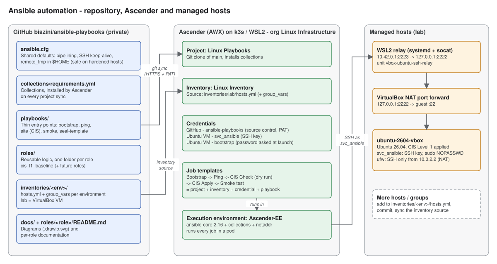

# Ansible automation

Playbooks, roles and inventories for the Linux estate, run from
**Ascender** (CIQ's distribution of AWX). Git is the source of truth:
Ascender pulls this repository, and every change to a host comes from a
commit here.



> The diagrams are `.drawio.svg` files. GitHub shows them as images, and
> draw.io (desktop, web or the VS Code extension) opens and edits them
> directly. Save them in the same format to keep both.

---

## Repository layout

```
ansible.cfg                  shared Ansible settings (picked up by Ascender)
collections/requirements.yml collections, installed by Ascender on project sync
inventories/
  lab/                       one folder per environment
    hosts.yml                hosts and groups
    group_vars/              variables per group (all.yml = every host)
playbooks/                   entry points, one file per job
roles/
  <role>/                    reusable logic, documented in its own README
docs/                        repository-level diagrams
```

| Path | What it is | Why it is organised this way |
|---|---|---|
| `playbooks/` | Short files that say *which hosts* get *which roles/tasks* | Each Ascender job template points at one playbook. Keeping them thin means the logic is written once, in a role, and reused by several playbooks. |
| `roles/` | Self-contained units: `tasks/`, `defaults/`, `handlers/`, `templates/`, `files/`, `README.md` | A role can be tested, versioned and documented on its own. `defaults/main.yml` lists every tunable with its default, so the role documents its own interface. |
| `inventories/<env>/` | Hosts, groups and the variables that make an environment different | Separating environments (lab, prod, ...) means the same playbook runs everywhere with different values. Inventory variables override role defaults. |
| `collections/requirements.yml` | External collections (`community.general`, `ansible.posix`, `ansible.utils`) | Ascender installs them automatically on every project sync, so jobs never depend on what happens to be installed in the execution environment. |
| `ansible.cfg` | Pipelining, SSH keep-alive, `remote_tmp` in `$HOME` | Settings that must hold for every job, including on hardened hosts where `/tmp` is `noexec`. Each line is commented in the file. |
| `docs/` | Diagrams | Architecture lives next to the code it describes and changes in the same commit. |

### Roles

| Role | Purpose | Documentation |
|---|---|---|
| `cis_l1_baseline` | CIS Level 1 Server hardening for Ubuntu 26.04 / 24.04, safe for unattended automation | [roles/cis_l1_baseline/README.md](roles/cis_l1_baseline/README.md) |

### Playbooks

| Playbook | Hosts | What it does |
|---|---|---|
| `bootstrap.yml` | `ubuntu_cis_l1`, `bastions` | One-off per host: creates the key-only automation account `svc_ansible`, using an existing sudo user whose password is typed at launch |
| `ping.yml` | all | Connectivity check: SSH login, sudo, OS and kernel |
| `site.yml` | `ubuntu_cis_l1`, `bastions` | Applies `cis_l1_baseline` (check mode for the dry run) |
| `smoke.yml` | `ubuntu_cis_l1`, `bastions` | Runs the CIS smoke script and fails if any check fails |
| `seal-template.yml` | all | Image builds only: removes host identity before a VM becomes a template |

---

## How Ascender runs this repository

Everything lives in organization **Linux Infrastructure**.

| Ascender object | Name | Points to |
|---|---|---|
| Project | Linux Playbooks | this repository, branch `main`, credential `GitHub - ansible-playbooks` |
| Inventory | Linux Inventory | inventory source `Linux Playbooks - lab` -> `inventories/lab/hosts.yml` (also loads `group_vars/`) |
| Credential (source control) | GitHub - ansible-playbooks | GitHub user + fine-grained token, read-only on this repository |
| Credential (machine) | Ubuntu VM - svc_ansible (SSH key) | key-only automation account, sudo without password |
| Credential (machine) | Ubuntu VM - bootstrap (gfilho) | existing sudo user; SSH and sudo passwords asked at launch, never stored |
| Job templates | Ubuntu VM - Bootstrap automation user, Ubuntu VM - Ping, Ubuntu CIS L1 - Check (dry run), Ubuntu CIS L1 - Apply, Ubuntu CIS L1 - Smoke test | project + inventory + credential + playbook |
| Team | Linux Team | team of the organization; grant it roles on the templates it should run |

What happens on every job launch:

1. The **inventory source** syncs from Git (`update on launch`), so new hosts
   and variable changes are picked up without a manual step.
2. The **execution environment** (Ascender-EE: ansible-core 2.16 plus
   collections) starts in a pod and checks out the project revision.
3. Ascender loads the **machine credential** into an ssh-agent and runs the
   playbook. That is why `ansible.cfg` must not set `IdentitiesOnly=yes`:
   with it, ssh ignores keys that come from the agent.

Push to `main`, then **Sync** the project (or enable "update revision on
launch") for jobs to use the new commit.

### Secrets

No secret is stored in this repository. Passwords, tokens and private keys
live in Ascender credentials, which are encrypted in its database and handed
to the job only at run time. `.gitignore` blocks the usual key and vault files
as a second line of defence. The public key of the automation account is in
`inventories/lab/group_vars/all.yml` on purpose: it is not secret and the role
installs it on every host.

---

## Lab network path

The lab host is an Ubuntu VM in VirtualBox on the same Windows workstation
that runs Ascender in WSL2 (k3s). The VM uses VirtualBox NAT, so it is not
reachable from the network on its own:

```
Ascender job pod --> 10.42.0.1:2223   relay on the WSL host (systemd unit vbox-ubuntu-ssh-relay, socat)
                 --> 127.0.0.1:2222  VirtualBox NAT port forward "ssh-ascender" (loopback only)
                 --> VM :22
```

- Pods live on the k3s network (10.42.x) and cannot reach the Windows
  loopback, where VirtualBox listens. The relay listens only on the k3s
  bridge (10.42.0.1), so it is not exposed to the LAN.
- Inside the VM every connection arrives from the NAT gateway `10.0.2.2`, so
  that is the only address the CIS firewall allows for SSH (`cis_mgmt_cidrs`).
- VirtualBox runs on top of Hyper-V (needed by WSL2). In that mode, live
  snapshots that save the VM memory are extremely slow. Take snapshots with the
  VM powered off, which only snapshots the disk and takes seconds.

---

## Adding things

**A host**: add it to `inventories/<env>/hosts.yml` under the right group,
commit and push. The inventory source syncs on the next job. For a new Ubuntu
server, run *Bootstrap*, then *Ping*, then the role's own run order (for CIS:
*Check*, *Apply*, reboot, *Smoke test*).

**A role**: create `roles/<name>/` with at least `tasks/main.yml`,
`defaults/main.yml` (every variable, with comments) and a `README.md` that
explains what the role changes and why. Prefix its variables with a short role
prefix, as `cis_` does, so they are easy to find in `group_vars`.

**A playbook**: a new file in `playbooks/` that targets a group and calls
roles. Then create a job template in Ascender (organization Linux
Infrastructure, project Linux Playbooks, inventory Linux Inventory) and give
the Linux Team access to it.

**A collection**: add it to `collections/requirements.yml` with a minimum
version. Ascender installs it on the next project sync.

## Local checks before pushing

```bash
ansible-galaxy collection install -r collections/requirements.yml
```
```bash
ansible-playbook --syntax-check playbooks/*.yml
```
```bash
ansible-lint
```
