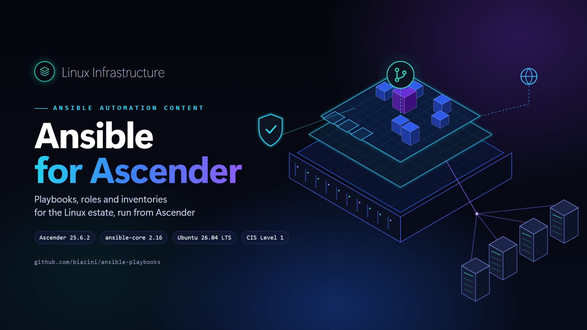
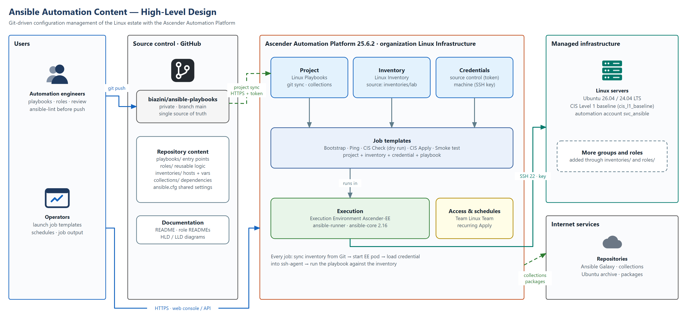
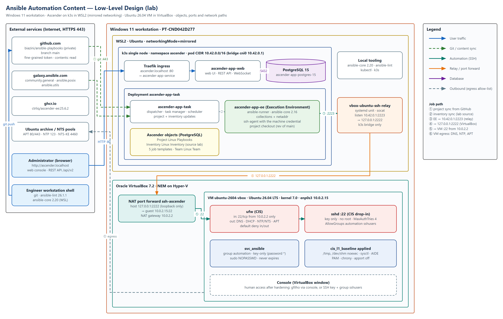
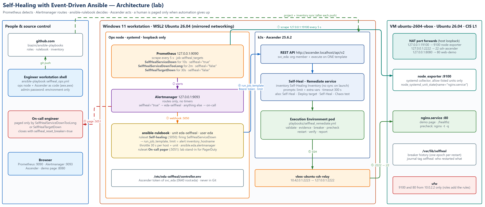

# Ansible Automation Content — Linux Infrastructure

Playbooks, roles and inventories that manage the Linux estate, executed from the **Ascender Automation Platform**. Git is the single source of truth: Ascender pulls this repository, and every change to a managed host comes from a reviewed commit here. The first content delivered is a **CIS Level 1 Server baseline for Ubuntu 26.04 LTS**, built to stay safe for unattended automation. The second is **self-healing with Event-Driven Ansible**: Prometheus detects a failed service, ansible-rulebook launches an Ascender job that heals it within seconds, and a human is paged only when automation gives up ([section 8](#8-self-healing-with-event-driven-ansible)).

| | |
|---|---|
| **Validated with** | Ascender 25.6.2 · Execution Environment `ascender-ee:25.6.2` (ansible-core 2.16) · k3s `v1.36.5+k3s1` · ansible-rulebook 1.3.2 · Prometheus 2.53 |
| **Managed platform** | Ubuntu 26.04 LTS (also 24.04 LTS), x86_64 |
| **Content** | Roles `ubuntu_base`, `cis_l1_baseline` and 6 self-healing roles · 10 playbooks · 1 rulebook · lab inventory |



## Contents

1. [Solution architecture](#1-solution-architecture)
2. [Introduction](#2-introduction)
3. [Prerequisites](#3-prerequisites)
4. [Software bill of materials](#4-software-bill-of-materials)
5. [Onboarding procedure](#5-onboarding-procedure)
6. [Development workflow](#6-development-workflow)
7. [Operations](#7-operations)
8. [Self-healing with Event-Driven Ansible](#8-self-healing-with-event-driven-ansible)
9. [Troubleshooting](#9-troubleshooting)
10. [Lessons learned](#10-lessons-learned)
- [Appendix A — Repository files](#appendix-a--repository-files)
- [Appendix B — References](#appendix-b--references)
- [License](#license)

### Repository layout

```text
.
├── .github/                      Security policy, code of conduct, contributing notes, templates
├── README.md                     This guide
├── LICENSE                       MIT License (code and configuration)
├── LICENSE-CC-BY-4.0             CC BY 4.0 (documentation and diagrams)
├── ansible.cfg                   Shared Ansible settings, picked up by Ascender
├── .ansible-lint                 Lint configuration for the whole repository
├── collections/
│   ├── requirements.yml          Collections installed by Ascender on every project sync
│   └── requirements-ops.yml      Collections for the self-healing ops node only (awx.awx)
├── docs/
│   ├── architecture/             HLD, LLD and self-healing architecture (draw.io sources + PNG exports)
│   └── images/                   Cover image
├── extensions/
│   └── eda/rulebooks/            Event-Driven Ansible rulebook (selfheal.yml)
├── inventories/
│   └── lab/                      hosts.yml + group_vars/ (one folder per environment);
│                                 ops.yml = self-healing ops node, local runs only
├── playbooks/                    Entry points, one per job template
└── roles/
    ├── cis_l1_baseline/          CIS Level 1 role, documented in its own README
    ├── ubuntu_base/              General Ubuntu settings outside CIS (keyboard, clean initramfs)
    ├── nginx_web/                Self-healing: demo workload (nginx + /healthz)
    ├── node_exporter/            Self-healing: Prometheus exporter, systemd state of allow-listed units
    ├── selfheal_remediate/       Self-healing: the remediation (validate, breaker, precheck, restart, verify)
    ├── selfheal_chaos/           Self-healing: failure injection for tests and game days
    ├── monitoring_stack/         Self-healing ops node: Prometheus + Alertmanager
    ├── eda_rulebook/             Self-healing ops node: ansible-rulebook as a systemd service
    └── selfheal_controller/      Self-healing: Ascender templates, EDA account and token as code
```

### Conventions

| Convention | Meaning |
|---|---|
| `bash` blocks | Commands run in a shell on the engineer workstation (WSL) or on a managed host, as stated in the step. |
| **Ascender →** | Path in the Ascender web console, e.g. **Ascender → Resources → Templates**. |
| `<VALUE>` | Site-specific value, e.g. `<HOST>` for an inventory host name. |
| ✅ **Expected result** | Output that confirms the step completed successfully. Do not proceed until it is met. |

---

## 1. Solution architecture

### 1.1 High-Level Design (HLD)



*Figure 1 — Ansible automation content HLD (source: [`Ansible-Automation-HLD.drawio`](docs/architecture/Ansible-Automation-HLD.drawio))*

### 1.2 Low-Level Design (LLD)



*Figure 2 — Lab deployment LLD (source: [`Ansible-Automation-LLD.drawio`](docs/architecture/Ansible-Automation-LLD.drawio))*

### 1.3 Architecture summary

Figure 1 is the logical view: engineers change content in Git, Ascender turns that content into job templates, and the Execution Environment applies it to the managed servers over SSH. Figure 2 is the lab as built: Ascender runs on k3s inside WSL2 on a Windows 11 workstation, and the managed host is an Ubuntu 26.04 VM in VirtualBox on the same machine, reached through a port forward and a relay.

- **Source control** — public GitHub repository `biazini/ansible-playbooks`, branch `main`. Ascender reads it with a fine-grained token that can only read this repository.
- **Control plane** — Ascender 25.6.2, organization **Linux Infrastructure**: project, inventory, credentials, job templates and team.
- **Execution** — every job runs in a pod from `ascender-ee:25.6.2` (ansible-runner, ansible-core 2.16, the collections and `netaddr`). The machine credential is loaded into an ssh-agent for the duration of the job only.
- **Managed hosts** — Ubuntu servers in inventory group `ubuntu_cis_l1`, administered through the key-only account `svc_ansible`.

### 1.4 Component inventory

| Component | Object / location | Responsibility |
|---|---|---|
| Repository | `github.com/biazini/ansible-playbooks` (public) | Playbooks, roles, inventories, collection requirements, documentation. |
| Project | **Linux Playbooks** · credential `GitHub - ansible-playbooks` | Clones `main` into Ascender and installs `collections/requirements.yml` on every sync. |
| Inventory | **Linux Inventory** · source `Linux Playbooks - lab` | Loads `inventories/lab/hosts.yml` and its `group_vars/`; syncs on every job launch. |
| Source control credential | `GitHub - ansible-playbooks` | GitHub user + fine-grained token (contents: read-only, this repository only). |
| Machine credential | `Ubuntu VM - svc_ansible (SSH key)` | Key-only automation account, sudo without password. Used by every job except bootstrap. |
| Machine credential | `Ubuntu VM - bootstrap (gfilho)` | Existing sudo user; SSH and sudo passwords are asked at launch and never stored. |
| Job templates | Bootstrap · Ping · Base Apply · CIS Check (dry run) · CIS Apply · Smoke test | Project + inventory + credential + playbook (see [2.3](#23-content-catalogue)). |
| Team | **Linux Team** | Receives roles on the templates it operates. |
| Execution Environment | `ghcr.io/ctrliq/ascender-ee:25.6.2` | Runtime of every project sync, inventory sync and job. |
| SSH relay (lab) | systemd unit `vbox-ubuntu-ssh-relay` in WSL (socat) | Bridges the k3s pod network to the VirtualBox port forward. |
| Port forward (lab) | VirtualBox NAT rule `ssh-ascender` | `127.0.0.1:2222` on Windows → VM port 22. |
| Self-healing objects | Templates **Self-Heal - Deploy target / Remediate service / Chaos test** · inventory **Self-Healing Inventory** · user `svc_eda` | Created by role `selfheal_controller`; see [section 8](#8-self-healing-with-event-driven-ansible). |
| Self-healing ops node (lab) | WSL: `prometheus`, `prometheus-alertmanager`, `eda-selfheal` (systemd) | Detect, route and react; all on loopback. |
| Port forwards (lab) | VirtualBox NAT rules `node-exporter`, `web-demo` | `127.0.0.1:19100` → VM 9100 · `127.0.0.1:8080` → VM 80. |

### 1.5 Network flows and ports

| # | Source → Destination | Protocol / port | Purpose |
|---|---|---|---|
| 1 | Ascender task pod → `github.com` | HTTPS 443/tcp | Project sync (`git`) with the fine-grained token. |
| 2 | Ascender task pod → `galaxy.ansible.com` | HTTPS 443/tcp | Collections from `collections/requirements.yml`. |
| 3 | Execution Environment → `10.42.0.1:2223` | SSH (TCP) | Job traffic to the lab VM, through the relay on the k3s bridge. |
| 4 | Relay → `127.0.0.1:2222` (Windows) | TCP | WSL2 mirrored networking shares the Windows loopback. |
| 5 | VirtualBox NAT → VM `10.0.2.15:22` | SSH 22/tcp | Arrives from the NAT gateway `10.0.2.2`, the only SSH source allowed by the host firewall. |
| 6 | VM → Internet | DNS 53, DHCP 67, NTP 123, NTS-KE 4460, HTTP/HTTPS 80/443 | Egress allow-list of the CIS firewall (resolution, lease, time, packages). |
| 7 | Administrator browser → `ascender.localhost` | HTTP 80/tcp | Web console and REST API (`/api/v2`). |
| 8 | Prometheus (WSL) → `127.0.0.1:19100` → VM `:9100` | HTTP | Self-healing: node_exporter scrape every 5 s, from `10.0.2.2` inside the VM (ufw rule added by role `node_exporter`). |
| 9 | Alertmanager → ansible-rulebook `127.0.0.1:5050` / `:5051` | HTTP | Self-healing: alert webhooks (remediation / on-call pager). |
| 10 | ansible-rulebook → `ascender.localhost` | HTTP 80/tcp | Self-healing: launch the remediation template (`svc_eda` token). |
| 11 | Browser → `127.0.0.1:8080` → VM `:80` | HTTP | Demo page served by nginx (role `nginx_web`). |

### 1.6 Design decisions

| Decision | Rationale |
|---|---|
| Git as the only source of change | Every host change is reviewable, reversible with `git revert`, and identical in every run. Nothing is edited by hand in Ascender except credentials. |
| Thin playbooks, logic in roles | A role is written and documented once and reused by several playbooks and job templates. |
| Inventory and variables in Git, loaded as an inventory source | Hosts and their settings are versioned with the code that uses them; `group_vars/` travel with `hosts.yml`. |
| Collections pinned in `collections/requirements.yml` | Jobs do not depend on what happens to be installed in the Execution Environment image. |
| Dedicated key-only automation account (`svc_ansible`) | No password to expire, leak or be locked out by PAM; access is revoked by removing one key. |
| Passwords asked at launch for bootstrap | The only password-based job never stores the password in Ascender. |
| Check mode before every first apply | The dry run shows every change as a diff before anything is touched. |
| Hardening built for automation | The CIS role never removes the access it relies on: preflight checks, validated SSH changes and a firewall that rolls itself back (see the [role README](roles/cis_l1_baseline/README.md)). |
| Relay bound to the k3s bridge only (lab) | Pods reach the VM, the LAN does not: the port forward listens on loopback and the relay on `10.42.0.1`. |
| Self-healing acts only through Ascender | ansible-rulebook holds no SSH key: it can only ask Ascender to run one template, so every automatic action has a job log, the same credential and the same audit trail as a human run. |

---

## 2. Introduction

### 2.1 Purpose

Provide versioned, reviewable automation content for the Linux estate and a documented way to run it from Ascender: from onboarding a new server to keeping it compliant.

### 2.2 Scope

- **In scope** — Ubuntu 26.04 / 24.04 LTS servers; the CIS Level 1 Server baseline; self-healing of allow-listed systemd services with Event-Driven Ansible; the Ascender objects that run the content; the lab network path.
- **Out of scope** — installing Ascender itself (see [ascender-k3s-installation](https://github.com/biazini/ascender-k3s-installation)); operating-system installation and disk layout; formal CIS compliance evidence (needs an independent audit tool).

### 2.3 Content catalogue

| Playbook | Hosts | Job template | What it does |
|---|---|---|---|
| `playbooks/bootstrap.yml` | `ubuntu_cis_l1`, `bastions` | Ubuntu VM - Bootstrap automation user | Once per host: creates `svc_ansible` (key, group, NOPASSWD sudo) as an existing sudo user. |
| `playbooks/ping.yml` | all | Ubuntu VM - Ping | SSH login, privilege escalation, OS and kernel report. Read-only. |
| `playbooks/base.yml` | `ubuntu_cis_l1`, `bastions` | Ubuntu Base - Apply | Applies role `ubuntu_base` (console keyboard layout, clean initramfs); job type Check or Run at launch. |
| `playbooks/site.yml` | `ubuntu_cis_l1`, `bastions` | Ubuntu CIS L1 - Check (dry run) / Apply | Applies role `cis_l1_baseline`; the Check template runs it in check mode with diff. |
| `playbooks/smoke.yml` | `ubuntu_cis_l1`, `bastions` | Ubuntu CIS L1 - Smoke test | Runs the role's smoke script and fails if any check fails. |
| `playbooks/seal-template.yml` | all | — | Image builds only: removes host identity before a VM becomes a template. |
| `playbooks/selfheal_target.yml` | `selfheal_targets` | Self-Heal - Deploy target | nginx demo site and node_exporter (roles `nginx_web`, `node_exporter`). |
| `playbooks/selfheal_remediate.yml` | `selfheal_targets` | Self-Heal - Remediate service | Heals one allow-listed unit on one host; launched by ansible-rulebook or by a person. |
| `playbooks/selfheal_chaos.yml` | `selfheal_targets` | Self-Heal - Chaos test | Stops, crashes or misconfigures a service on purpose (survey). |
| `playbooks/selfheal_ops.yml` | `selfheal_ops` | — (workstation) | Ops node (Prometheus, Alertmanager, ansible-rulebook) and the Ascender objects above. |

| Role | Purpose | Documentation |
|---|---|---|
| `ubuntu_base` | General Ubuntu settings outside CIS: console keyboard layout (pt), initramfs without unused dracut modules | [roles/ubuntu_base/README.md](roles/ubuntu_base/README.md) |
| `cis_l1_baseline` | CIS Ubuntu 26.04 Level 1 Server hardening, safe for unattended automation | [roles/cis_l1_baseline/README.md](roles/cis_l1_baseline/README.md) |
| `nginx_web` | Self-healing demo workload: nginx, one page and `/healthz` | [roles/nginx_web/README.md](roles/nginx_web/README.md) |
| `node_exporter` | Prometheus node_exporter, systemd state of the allow-listed units only | [roles/node_exporter/README.md](roles/node_exporter/README.md) |
| `selfheal_remediate` | Heal one unit safely: validation, evidence, circuit breaker, precheck, restart, verification | [roles/selfheal_remediate/README.md](roles/selfheal_remediate/README.md) |
| `selfheal_chaos` | Failure injection for tests and game days | [roles/selfheal_chaos/README.md](roles/selfheal_chaos/README.md) |
| `monitoring_stack` | Prometheus + Alertmanager on the ops node, self-healing rules and routing | [roles/monitoring_stack/README.md](roles/monitoring_stack/README.md) |
| `eda_rulebook` | ansible-rulebook as a hardened systemd service | [roles/eda_rulebook/README.md](roles/eda_rulebook/README.md) |
| `selfheal_controller` | Ascender templates, least-privilege EDA account and token, as code | [roles/selfheal_controller/README.md](roles/selfheal_controller/README.md) |

---

## 3. Prerequisites

### 3.1 Controller

- Ascender 25.6.2 reachable by the operators, with organization **Linux Infrastructure** and the objects in [1.4](#14-component-inventory).
- Outbound HTTPS from the Ascender pods to GitHub, Ansible Galaxy and `ghcr.io`.

### 3.2 Managed hosts

| Requirement | Why |
|---|---|
| Ubuntu 26.04 or 24.04 LTS, `python3` | Supported releases of the CIS role; Ansible modules run with the host's Python. |
| `openssh-server` installed and running | Ubuntu Desktop images do not include it; Ascender connects over SSH. |
| A sudo-capable user and its password (first run only) | Used once by the bootstrap job to create `svc_ansible`. |
| Network path from the Execution Environment to port 22 | The source address must be listed in `cis_mgmt_cidrs` before the CIS firewall is applied. |
| Console access (hypervisor or iLO/iDRAC) | Recovery path during the first hardening run. |

### 3.3 Engineer workstation

`git`, `ansible-core` and `ansible-lint` (WSL: `sudo apt install ansible ansible-lint`), and a GitHub account with write access to this repository.

---

## 4. Software bill of materials

### 4.1 Platform

| Component | Version | Notes |
|---|---|---|
| Ascender | 25.6.2 | `ghcr.io/ctrliq/ascender:25.6.2`, operator `ascender-operator:25.6.2` |
| k3s | v1.36.5+k3s1 | Single node in WSL2 (Ubuntu 26.04.1, mirrored networking) |
| Oracle VirtualBox | 7.2.6 | Runs on Hyper-V (NEM) because WSL2 is enabled |

### 4.2 Execution Environment (`ascender-ee:25.6.2`)

| Component | Version |
|---|---|
| ansible-core | 2.16.19 |
| community.general | 13.4.0 (requirement `>=9.0.0`) |
| ansible.posix | 2.2.2 (requirement `>=1.5.0`) |
| ansible.utils | 6.1.0 (requirement `>=4.0.0`) |
| netaddr (Python) | 1.3.0 |

### 4.3 Managed host (lab)

| Component | Version |
|---|---|
| Ubuntu | 26.04.1 LTS, kernel 7.0.0-38-generic |
| OpenSSH | 10.2p1 |
| sudo | sudo-rs 0.2.13 (classic sudo available as `sudo.ws`) |
| Python | 3.14.4 |
| nginx (self-healing demo) | 1.28.3 (Ubuntu archive) |
| prometheus-node-exporter | 1.10.2 (Ubuntu archive) |

### 4.4 Engineer tooling

| Component | Version |
|---|---|
| ansible-core (WSL) | 2.20.1 |
| ansible-lint | 26.1.1 |
| awx.awx (Ubuntu `ansible` package) | 24.6.1 |

### 4.5 Self-healing ops node (WSL)

| Component | Version | Notes |
|---|---|---|
| Prometheus | 2.53.5 | Ubuntu archive, `127.0.0.1:9090` |
| Alertmanager | 0.28.1 | Ubuntu archive, `127.0.0.1:9093`, HA gossip off |
| ansible-rulebook | 1.3.2 | venv `/opt/eda-selfheal/venv` (Python 3.14, drools_jpy 0.4.1) |
| ansible.eda | 2.13.0 | `/opt/eda-selfheal/collections` (source `ansible.eda.alertmanager`) |
| OpenJDK | 21.0.12 (`openjdk-21-jre-headless`) | Rule engine (Drools) of ansible-rulebook |

---

## 5. Onboarding procedure

Bring a new Ubuntu server under management and apply the CIS baseline. Run the job templates from **Ascender → Resources → Templates**.

### 5.1 Phase 1 — Prepare the host

On the host console:

```bash
sudo apt update && sudo apt install -y openssh-server
```
```bash
sudo systemctl enable --now ssh && sudo ss -ltnp | grep ':22 '
```

✅ **Expected result** — `sshd` is listening on port 22.

### 5.2 Phase 2 — Add the host to the inventory

Add the host under group `ubuntu_cis_l1` in `inventories/<env>/hosts.yml` with its `ansible_host` (and `ansible_port` if not 22). Check that the address Ascender connects from is in `cis_mgmt_cidrs` in `group_vars/all.yml`, then commit and push (see [6](#6-development-workflow)). The inventory source syncs on the next job launch.

✅ **Expected result** — **Ascender → Inventories → Linux Inventory → Hosts** lists `<HOST>` after the next sync.

### 5.3 Phase 3 — Bootstrap the automation account

Launch **Ubuntu VM - Bootstrap automation user** with **Limit** `<HOST>`. Enter the sudo user's password in **SSH password** and **Privilege escalation password**.

✅ **Expected result** — `failed=0`; tasks *Group exists*, *User exists*, *Authorized keys* and *Group allowed to sudo* report `changed` on the first run.

### 5.4 Phase 4 — Connectivity check and base settings

Launch **Ubuntu VM - Ping**, then **Ubuntu Base - Apply**.

✅ **Expected result** — `SSH login as svc_ansible, become -> root` and `failed=0` for both; the base job rebuilds the initramfs (effective at the reboot in Phase 7).

### 5.5 Phase 5 — Dry run

Launch **Ubuntu CIS L1 - Check (dry run)** and read the diff of every changed task.

✅ **Expected result** — `failed=0`. The preflight assertions pass (connecting address inside `cis_mgmt_cidrs`, user allowed by `AllowGroups`).

### 5.6 Phase 6 — Apply the baseline

Take a snapshot or backup of the host (powered off for VirtualBox, see [7.4](#74-snapshots-of-the-lab-vm)) and keep its console open. Launch **Ubuntu CIS L1 - Apply**.

✅ **Expected result** — `failed=0`; *SSH | Fresh login works* and *Firewall | New SSH session gets through the firewall* report `ok`; the summary asks for a reboot.

### 5.7 Phase 7 — Reboot and verify

Reboot the host (applies the `/tmp` mount options), then launch **Ubuntu CIS L1 - Smoke test**.

✅ **Expected result** — `Result: 37 passed, 0 failed`.

---

## 6. Development workflow

1. Change content on a branch or directly on `main` (personal repository).
2. Check locally, from a clone inside the WSL filesystem (Ansible ignores `ansible.cfg` in world-writable folders such as `/mnt/c`):
   ```bash
   ansible-galaxy collection install -r collections/requirements.yml
   ```
   ```bash
   ansible-playbook --syntax-check playbooks/*.yml
   ```
   ```bash
   ansible-lint
   ```
   ✅ **Expected result** — no syntax errors; `ansible-lint` passes with profile `production`.
3. Commit and push. Sync the project in **Ascender → Resources → Projects → Linux Playbooks**.
4. Run **Check (dry run)** before **Apply** for any change to a role.

| To add | Do this |
|---|---|
| A host | Add it to `inventories/<env>/hosts.yml`, push, follow [5](#5-onboarding-procedure). |
| A role | `roles/<name>/` with `tasks/main.yml`, `defaults/main.yml` (every variable commented), `README.md` and a diagram in `roles/<name>/docs/`. Use a short variable prefix. |
| A playbook | `playbooks/<name>.yml` targeting a group; create its job template in organization Linux Infrastructure and grant Linux Team access. |
| A collection | Add it with a minimum version to `collections/requirements.yml`. |

Diagrams are edited in draw.io (desktop, web or the VS Code extension). After editing a `.drawio` file, export it to PNG next to the source at 200 % zoom with a white background.

---

## 7. Operations

### 7.1 Keeping hosts compliant

Add a schedule to **Ubuntu CIS L1 - Apply** (for example weekly). Package updates can revert files or permissions; a run on a compliant host reports `changed=0` or close to it.

### 7.2 Credential rotation

| Credential | When | How |
|---|---|---|
| GitHub token | Before it expires, or when exposed | Regenerate it in GitHub (fine-grained, contents read-only, this repository) and paste it in **Password** of `GitHub - ansible-playbooks`. |
| `svc_ansible` SSH key | Periodically, or when exposed | Generate a new key, add the public key to `cis_automation_pubkeys`, run **Apply**, replace the private key in the machine credential, remove the old public key and run **Apply** again. |
| `svc_eda` API token (self-healing) | Periodically, or when exposed | Run `playbooks/selfheal_ops.yml --tags controller -e selfheal_rotate_token=true` ([8.4](#84-deployment-procedure)): every token of the account is revoked, a new one is written and `eda-selfheal` restarts. |

### 7.3 Job logs

Job output is kept in **Ascender → Views → Jobs**. Each job records the project revision (`scm_revision`) it ran, which identifies the exact commit applied.

### 7.4 Snapshots of the lab VM

VirtualBox runs on Hyper-V (NEM) because WSL2 is enabled. In this mode, live snapshots that save the VM memory are extremely slow and can leave the VM suspended. Shut the VM down cleanly and take the snapshot powered off (disk only, a few seconds).

### 7.5 Lab relay

```bash
systemctl status vbox-ubuntu-ssh-relay
```

The relay starts after k3s at boot and restarts on failure. It listens on `10.42.0.1:2223` (k3s bridge) and forwards to `127.0.0.1:2222`.

---

## 8. Self-healing with Event-Driven Ansible

When an allow-listed service dies on a managed host, it comes back on its own in about half a minute, through a normal Ascender job with a full log. When automation cannot fix it, or should not keep trying, a human is paged with the evidence already collected.

### 8.1 Architecture



*Figure 3 — Self-healing architecture (source: [`Self-Healing-EDA.drawio`](docs/architecture/Self-Healing-EDA.drawio))*

| # | Step | Where |
|---|---|---|
| ① | Prometheus scrapes node_exporter every 5 s. Only the units in `selfheal_services` are exported (`node_systemd_unit_state`). | `monitoring_stack`, `node_exporter` |
| ② | The unit is not `active` for 10 s: **SelfHealServiceDown** fires with `selfheal="true"` and the label `inventory_hostname`. | `selfheal.rules.yml` |
| ③ | Alertmanager sends `selfheal="true"` alerts to ansible-rulebook and everything else to on-call. It only routes: all timers are Prometheus `for` clauses. | `alertmanager.yml` |
| ④ | The rulebook launches **Self-Heal - Remediate service** as `svc_eda`, with `--limit` = the alert's host and the alert itself in the extra vars (`ansible_eda`). | `extensions/eda/rulebooks/selfheal.yml` |
| ⑤ | The job validates the request, collects evidence, applies the circuit breaker and the config precheck, restarts the unit and verifies it (unit active + `/healthz`). | `selfheal_remediate` |
| ⑥ | Still down after 2 minutes, for any reason: **SelfHealServiceDownTooLong** pages on-call. Host unreachable: **SelfHealTargetDown**. | `selfheal.rules.yml` |

### 8.2 Design decisions

| Decision | Rationale |
|---|---|
| The rulebook only launches a template | ansible-rulebook holds no SSH key and no inventory. Every automatic action is an Ascender job: same credential, same log, same RBAC as a human run, and it can be replayed by hand. |
| Least-privilege API account `svc_eda` | Organization member (to find the template by name) and **execute** on one template. A stolen token can restart allow-listed services, nothing else. |
| The event is never trusted | The playbook requires exactly one host, a well-formed unit name and a unit on that host's `selfheal_services` allow-list, whatever the alert says. |
| Allow-list in the inventory | One list (`group_vars/selfheal_targets.yml`) drives what is exported, what alerts, what may be restarted and what the chaos test may break. |
| Circuit breaker (3 automatic restarts / 10 min) | A unit that keeps dying needs a person. The history lives on the host (`/var/lib/selfheal`), so it survives a controller rebuild and is visible to whoever logs in. Manual launches are never limited. |
| Diagnose before acting | `nginx -t` before the restart: a broken configuration is escalated with the exact error instead of being restarted in a loop. |
| Escalation is a Prometheus timer | `SelfHealServiceDownTooLong` (`for: 2m`) needs no message from the automation, so it pages even if ansible-rulebook or Ascender is down. Alertmanager `group_wait` was tried first and fails with flapping services (see [10](#10-lessons-learned)). |
| Remediation inventory without sync on launch | **Linux Inventory** syncs the inventory and the project on every launch (about 45 s). **Self-Healing Inventory** reads the same `hosts.yml`, synced after each push and hourly: a remediation starts in under a second. |
| Everything as code | Ops node services, alert rules, routing, rulebook, templates, account and token: one playbook rebuilds all of it. Only the admin password is typed, into an environment variable. |
| Loopback only on the ops node | Prometheus, Alertmanager and the rulebook webhooks listen on `127.0.0.1`; under WSL mirrored networking `0.0.0.0` would mean the LAN. |

### 8.3 Lab prerequisites

- The host is bootstrapped and reachable by Ascender (sections [5.1](#51-phase-1--prepare-the-host)–[5.4](#54-phase-4--connectivity-check-and-base-settings)).
- Port forwards for the exporter and the demo page, on the Windows workstation (loopback only, like `ssh-ascender`):

  ```bash
  VBoxManage controlvm "Ubuntu  26.04 LTS" natpf1 "node-exporter,tcp,127.0.0.1,19100,,9100"
  ```
  ```bash
  VBoxManage controlvm "Ubuntu  26.04 LTS" natpf1 "web-demo,tcp,127.0.0.1,8080,,80"
  ```

- The host is listed under `selfheal_targets` in `inventories/lab/hosts.yml` with `selfheal_exporter_target` (the scrape address).

### 8.4 Deployment procedure

**Phase 1 — Ops node and Ascender objects.** From the clone inside the WSL filesystem, as root:

```bash
ansible-galaxy collection install -r collections/requirements-ops.yml
```
```bash
export CONTROLLER_HOST=http://ascender.localhost CONTROLLER_USERNAME=admin
```
```bash
read -rsp 'Ascender password: ' CONTROLLER_PASSWORD && export CONTROLLER_PASSWORD
```
```bash
ansible-playbook -i inventories/lab/ playbooks/selfheal_ops.yml
```

✅ **Expected result** — `failed=0`; `systemctl is-active prometheus prometheus-alertmanager eda-selfheal` prints `active` three times; **Ascender → Templates** lists the three `Self-Heal -` templates and **Ascender → Users** lists `svc_eda`.

**Phase 2 — Monitored workload.** Launch **Self-Heal - Deploy target** with **Limit** `<HOST>`.

✅ **Expected result** — `failed=0`; <http://127.0.0.1:8080> shows the demo page; in Prometheus (<http://localhost:9090>) `node_systemd_unit_state{state="active"}` is `1` for `nginx.service` and target `selfheal_targets` is **UP**.

**Phase 3 — End-to-end test.** Launch **Self-Heal - Chaos test** with **Limit** `<HOST>` and *Failure to inject* `kill`.

✅ **Expected result** — within about 30 s **Views → Jobs** shows **Self-Heal - Remediate service** launched by `svc_eda`, `successful`, ending with `HEALED` and the outage timeline; the demo page is back.

Re-run the ops playbook after every change to roles `monitoring_stack`, `eda_rulebook` or `selfheal_controller`, or to the rulebook. Tags: `monitoring`, `eda`, `controller`.

### 8.5 Test scenarios

All launched from **Self-Heal - Chaos test** (survey) on the lab VM, 20 Oct 2026.

| Scenario | What happens | Result in the lab |
|---|---|---|
| `kill` (crash, unit `failed`) | Alert, rulebook, remediation, restart, verification | Healed 8 times out of 8 · outage **31–39 s** (detection 15–19 s, alert to healthy 16–21 s) · job 15–21 s |
| `stop` (operator mistake) | Same path as `kill` | Healed · outage 35 s (detection 17 s, alert to healthy 18 s) |
| 4 crashes in 10 minutes | Restarts 1/3, 2/3, 3/3; the 4th job fails with `ESCALATE - circuit breaker open`, no restart | On-call paged 2 min later (`SelfHealServiceDownTooLong`) |
| `break_config` (bad nginx config + crash) | Precheck fails: `ESCALATE` with `unknown directive "this_directive_does_not_exist"`, no restart | Escalated in 14 s with the exact error |
| `restore`, then the human closes | **Self-Heal - Remediate service** with `selfheal_reset_breaker: true` | History cleared, unit healed, `RESOLVED` sent to on-call |

### 8.6 Operating it

| Task | How |
|---|---|
| See what automation did | **Views → Jobs**, label `self-healing`. Each remediation shows the triggering alert (`ansible_eda` in the extra vars), the evidence, the decision and the timeline; on the host, `journalctl -t selfheal`. |
| Close an escalated incident | Fix the cause, then launch **Self-Heal - Remediate service** with **Limit** `<HOST>` and extra vars `selfheal_service: <unit>` and `selfheal_reset_breaker: true`. |
| Heal another service | Add it to `selfheal_services` (unit, precheck, health_url) in `group_vars/selfheal_targets.yml`, push, run **Self-Heal - Deploy target** (exports the new unit) and the ops playbook (syncs the inventory). |
| Add a host | Add it to `selfheal_targets` with its `selfheal_exporter_target`, push, run **Self-Heal - Deploy target** on it and the ops playbook (new scrape target). |
| See the pages | `journalctl -u eda-selfheal -g 'PAGE ON-CALL'` (lab stand-in; production: a PagerDuty / Opsgenie / Teams receiver in `alertmanager.yml`). |
| Watch the chain live | Prometheus <http://localhost:9090/alerts>, Alertmanager <http://localhost:9093>, `journalctl -fu eda-selfheal`. |

### 8.7 From lab to production

- Replace the systemd rulebook with an **EDA Controller** activation: the rulebook already lives in `extensions/eda/rulebooks/`, the layout an EDA project expects.
- Run Prometheus and Alertmanager in HA (two Alertmanagers in a cluster) and put the on-call receiver on a real paging service.
- Scrape intervals of 15–30 s and `for: 30s` on a large fleet; detection then takes about a minute.
- HTTPS for Ascender (`EDA_CONTROLLER_SSL_VERIFY=yes` is set automatically for an `https://` URL).

---

## 9. Troubleshooting

| Symptom | Cause | Resolution |
|---|---|---|
| Project sync fails: `Authentication failed` / `Repository not found` | Source control credential without username, or token without access to the repository | Fill **Username** in the credential; check the token's repository access and expiry. |
| Project sync hangs on `git ls-remote` | Git waiting for credentials after an authentication error | Cancel the update, fix the credential, sync again. |
| `Timeout waiting for privilege escalation prompt` | sudo-rs does not print the prompt Ansible 2.16 expects | Use `ansible_become_exe: sudo.ws` for password-based become (already set in `bootstrap.yml`). |
| `Permission denied (publickey)` with a correct key | `IdentitiesOnly=yes` makes ssh ignore keys from the ssh-agent | Keep `IdentitiesOnly` out of `ansible.cfg` (current setting). |
| SSH `Connection reset by peer` on the port forward | No `sshd` listening in the VM | Install and enable `openssh-server` ([5.1](#51-phase-1--prepare-the-host)). |
| Check mode fails: `check mode and async cannot be used` | Async task without a check-mode guard | Guard the task with `not ansible_check_mode` (done for AIDE). |
| Smoke test: `fs.suid_dumpable` = 2 | apport rewrites it at start | Role disables apport (`cis_disable_apport`). |
| Boot shows `copymods is deprecated`, `/lib/modules/... exists` or `ln: ... /sysroot/media/root-ro` | Unused dracut modules from Ubuntu 26.04 defaults | Run **Ubuntu Base - Apply** and reboot (role `ubuntu_base`). |
| VM stops in initramfs: `Can't mount root filesystem` | Root `fsck` killed by a timeout after an unclean stop | From the emergency shell: `e2fsck -p /dev/sda2`, then `systemctl reboot`. |
| `ansible.cfg` ignored when running locally | Repository in a world-writable folder (`/mnt/c/...`) | Clone inside the WSL filesystem, e.g. `~/ansible-playbooks`. |
| Self-healing: remediation job `failed` with *Previous Task Failed* (inventory or project update), `elapsed 0` | Template on a per-job branch override (`selfheal_scm_branch`) or an inventory that syncs on launch: every job re-clones and re-downloads the collections, and a Galaxy timeout kills the job before it starts | Keep `selfheal_scm_branch` empty and the remediation on **Self-Healing Inventory** (no update on launch). |
| Self-healing: nothing happens after a crash | Check the chain in order: Prometheus target UP and alert firing → Alertmanager shows it → `journalctl -u eda-selfheal` shows `POST /alerts` and `Job Launched` | A `401` from Ascender in the rulebook log: re-issue the token (`--tags controller -e selfheal_rotate_token=true`). |
| `eda-selfheal` does not start | `/etc/eda-selfheal/controller.env` missing (token not issued yet) | Run the ops playbook with tag `controller`. |
| `ascender.localhost` not resolved inside WSL (Python fails, curl works) | glibc only resolves `localhost` from `/etc/hosts`; curl and browsers special-case `*.localhost` | `libnss-myhostname` + `myhostname` in `/etc/nsswitch.conf` (role `eda_rulebook`). |
| `nginx: "server_tokens" directive is duplicate` | Ubuntu 26.04 already sets `server_tokens off` at http level | Set it at server level (role `nginx_web` does). |
| Warning `You are running collection version 24.6.1 but connecting to AWX version 25.6.2` | Ascender reports its own version as the AWX version | Harmless: awx.awx 24.6.1 is the latest collection and works with Ascender 25.6.2. |

---

## 10. Lessons learned

- **Ubuntu 26.04 changes the automation surface.** sudo-rs replaces sudo (no `logfile`, different password prompt) and OpenSSH 10.2 adds post-quantum key exchange. Content must detect, not assume.
- **Hardening must protect its own access path.** Preflight assertions, `sshd -t` with rollback, reconnect tests and a self-cancelling firewall timer turned the riskiest changes into routine runs.
- **Every Ascender quirk belongs in configuration.** The ssh-agent behaviour (`IdentitiesOnly`) and the Execution Environment's ansible-core version decided two of the fixes; both are documented where they live (`ansible.cfg`, `bootstrap.yml`).
- **Verify with the effective state, not the files.** The smoke test reads `sshd -T`, `findmnt` and `sysctl`, which is how the apport override was found.
- **Hypervisor stacking matters.** VirtualBox on Hyper-V cannot take usable live snapshots; plan offline snapshots.
- **The remediation path must not depend on the Internet.** The first automatic remediation died before its first task: a per-job branch sync re-downloaded the collections and Galaxy timed out. Anything a remediation job does before its first task (project sync, inventory sync, collection install) is part of the outage.
- **Measure the platform overhead, not only the playbook.** The playbook took 16 s; "update on launch" on the inventory added 45 s more. A dedicated inventory synced on push cut the job start to under a second.
- **Alertmanager is a router, not a timer.** Escalating with `group_wait` paged a flapping service 20 s into an incident that healed by itself, and never paged the one that opened the circuit breaker. A second Prometheus rule with `for: 2m` gives every incident its own timer and also covers "the automation itself is down".
- **Test the guardrails, not only the happy path.** The circuit breaker passed every review and failed its first test: `join('\n')` inside a YAML block wrote a literal backslash-n, so the restart history never reached the limit. Only the chaos test showed it.
- **Automation needs a stop condition and a human exit.** Three restarts in ten minutes, a config precheck and an explicit reset by a person keep self-healing from hiding real problems.

---

## Appendix A — Repository files

| File | Purpose |
|---|---|
| [`ansible.cfg`](ansible.cfg) | Pipelining, SSH keep-alive, `remote_tmp` in `$HOME`; every line commented. |
| [`collections/requirements.yml`](collections/requirements.yml) | Collections and minimum versions. |
| [`inventories/lab/hosts.yml`](inventories/lab/hosts.yml) | Lab hosts and groups, with the network path explained. |
| [`inventories/lab/group_vars/all.yml`](inventories/lab/group_vars/all.yml) | Automation account key, management networks, egress allow-list, keyboard layout. |
| [`inventories/lab/group_vars/bastions.yml`](inventories/lab/group_vars/bastions.yml) | Jump-host exception (SSH forwarding). |
| [`playbooks/`](playbooks/) | Entry points; each file starts with what, when and why. |
| [`roles/cis_l1_baseline/`](roles/cis_l1_baseline/) | CIS role, its README and task-flow diagram. |
| [`roles/ubuntu_base/`](roles/ubuntu_base/) | General Ubuntu settings, its README and task-flow diagram. |
| [`collections/requirements-ops.yml`](collections/requirements-ops.yml) | Collections for the self-healing ops node only (not read by Ascender). |
| [`inventories/lab/ops.yml`](inventories/lab/ops.yml) | Self-healing ops node (the workstation), local runs only. |
| [`inventories/lab/group_vars/selfheal_targets.yml`](inventories/lab/group_vars/selfheal_targets.yml) | Self-healing allow-list, circuit breaker limits, scrape sources. |
| [`inventories/lab/group_vars/selfheal_ops.yml`](inventories/lab/group_vars/selfheal_ops.yml) | Ascender URL and the existing objects the self-healing templates use. |
| [`extensions/eda/rulebooks/selfheal.yml`](extensions/eda/rulebooks/selfheal.yml) | Event-Driven Ansible rulebook: remediation ruleset and lab on-call pager. |
| [`roles/selfheal_remediate/`](roles/selfheal_remediate/) and the other self-healing roles | Each with its README; task-flow diagram for the remediation. |

## Appendix B — References

- Ascender: <https://github.com/ctrliq/ascender> · documentation: <https://ascender-automation.org>
- Ascender installation guide: <https://github.com/biazini/ascender-k3s-installation>
- Ansible documentation: <https://docs.ansible.com>
- ansible-lint: <https://ansible.readthedocs.io/projects/lint/>
- CIS Ubuntu Linux Benchmarks: <https://www.cisecurity.org/benchmark/ubuntu_linux>
- Ubuntu Security Guide (USG): <https://ubuntu.com/security/certifications/docs/usg>
- ansible-rulebook (Event-Driven Ansible): <https://ansible.readthedocs.io/projects/rulebook/>
- ansible.eda collection (event sources): <https://github.com/ansible/event-driven-ansible>
- Prometheus alerting rules: <https://prometheus.io/docs/prometheus/latest/configuration/alerting_rules/>
- Alertmanager configuration: <https://prometheus.io/docs/alerting/latest/configuration/>

## License

This repository is dual-licensed:

| Content | License |
|---|---|
| Code and configuration — playbooks, roles, inventories, configuration files and the commands and code samples in this README | [MIT License](LICENSE) |
| Documentation and diagrams — the prose of this README and of the role READMEs, and everything under `docs/` folders | [Creative Commons Attribution 4.0 International (CC BY 4.0)](LICENSE-CC-BY-4.0) |

When reusing the documentation or diagrams, give appropriate credit, for example:

> *"Ansible Automation Content — Linux Infrastructure" by Guilherme Filho, licensed under [CC BY 4.0](https://creativecommons.org/licenses/by/4.0/).*

This content is provided "as is", without warranty of any kind. Validate every change in a non-production environment before applying it to production systems.

Ascender is a project of CIQ; Ansible is a trademark of Red Hat, Inc.; CIS Benchmarks are published by the Center for Internet Security. Product names and trademarks belong to their respective owners and are not covered by the licenses above.
