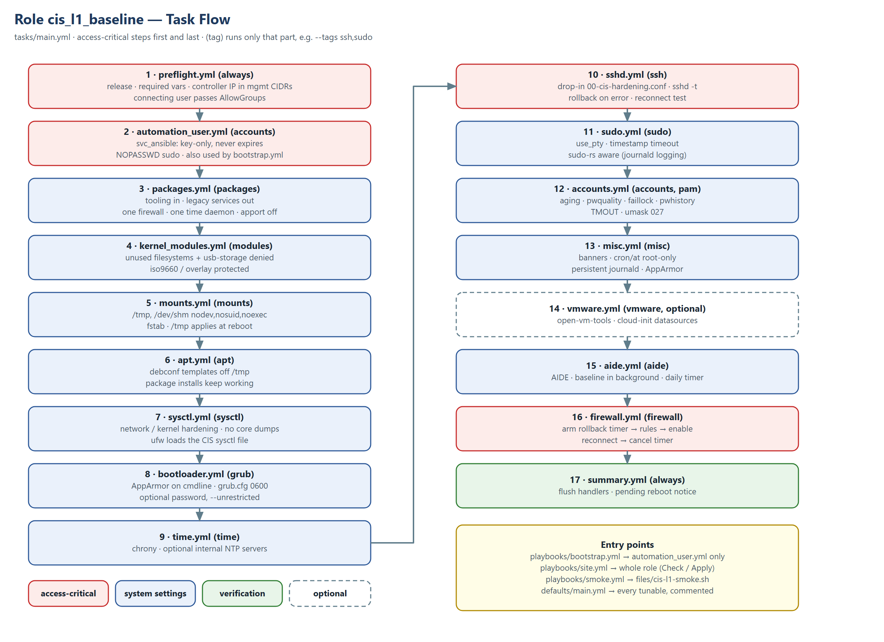

# cis_l1_baseline — CIS Level 1 Server Baseline for Ubuntu

Applies the **CIS Ubuntu Linux 26.04 LTS Benchmark, Level 1 – Server** profile (also runs on 24.04). It is built for hosts managed by automation (Ascender, Terraform, Packer): the hardening must never cut off the tools that manage the host.

| | |
|---|---|
| **Target** | Ubuntu 26.04 LTS · Ubuntu 24.04 LTS |
| **Benchmark** | CIS Ubuntu Linux 26.04 LTS v1.0.0 · Level 1 – Server |
| **Requires** | ansible-core ≥ 2.16 · `community.general` · `ansible.posix` · `ansible.utils` · `netaddr` on the controller |
| **Validated** | Ubuntu 26.04.1 LTS · smoke test 37/37 · second run `changed=0` (before the 26.04 v1.0.0 reconciliation; the 14 checks added with it still need a run on a host) |

> [!IMPORTANT]
> Control numbers in this README and in `defaults/main.yml` were reconciled against the CIS Ubuntu Linux 26.04 LTS Benchmark v1.0.0 PDF. Level 1 controls the role does not automate are listed in [5.1](#51-level-1-controls-not-automated). Audit with an independent tool before claiming compliance (see [6. Verification](#6-verification)).

## Contents

1. [Task flow](#1-task-flow)
2. [Usage](#2-usage)
3. [What the role changes, and why](#3-what-the-role-changes-and-why)
4. [Host types and overrides](#4-host-types-and-overrides)
5. [Exceptions register](#5-exceptions-register)
6. [Verification](#6-verification)
7. [Role files](#7-role-files)

---

## 1. Task flow



*Figure 1 — Order of the task files in `tasks/main.yml`, with their tags (source: [`cis_l1_baseline-flow.drawio`](docs/cis_l1_baseline-flow.drawio))*

Access-critical steps come first (preflight, automation account) and last (firewall), with SSH in between re-tested by reconnecting. Every block has a tag, so a part can be re-applied alone, e.g. `--tags ssh,sudo` or the **Job Tags** field in Ascender.

---

## 2. Usage

### 2.1 Run order

| Step | Playbook | Ascender job template | Notes |
|---|---|---|---|
| 1 | `playbooks/bootstrap.yml` | Ubuntu VM - Bootstrap automation user | Once per host. Runs only `tasks/automation_user.yml`, as an existing sudo user whose password is typed at launch |
| 2 | `playbooks/ping.yml` | Ubuntu VM - Ping | Proves key login and sudo work as `svc_ansible` |
| 3 | `playbooks/site.yml` (check mode) | Ubuntu CIS L1 - Check (dry run) | Shows every change as a diff, changes nothing |
| 4 | `playbooks/site.yml` | Ubuntu CIS L1 - Apply | First time: keep the VM console open |
| 5 | reboot | - | Applies the new `/tmp` mount options |
| 6 | `playbooks/smoke.yml` | Ubuntu CIS L1 - Smoke test | Runs `files/cis-l1-smoke.sh` on the host |

Re-run **Apply** on a schedule (an Ascender schedule on the job template).
Package updates (grub, openssh, apport) can change files or permissions back,
and the role puts them right again. A second run should report only a few
changes.

Run part of the role with tags (the tag of each step is in Figure 1), for
example `--tags ssh,sudo` or, in Ascender, the *Job Tags* field.

### 2.2 Variables

Every tunable is in [`defaults/main.yml`](defaults/main.yml), with a comment
explaining it. Site values go in `inventories/<env>/group_vars/`. Two are
required, and the preflight stops the run without them:

| Variable | Purpose |
|---|---|
| `cis_automation_pubkeys` | Public key(s) of the automation account. Without a key, the account could not log in once password SSH is off. |
| `cis_mgmt_cidrs` | Networks allowed to reach SSH once the firewall is on. Must contain the address the controller connects from. |

---

## 3. What the role changes, and why

### 3.1 Access first: preflight and the automation account

**Preflight** (`tasks/preflight.yml`) runs before anything changes. It checks
the Ubuntu release, that the two required variables are set, that the address
Ansible is connecting from is inside `cis_mgmt_cidrs`, and that the
connecting user will still pass `AllowGroups`. These are the four ways
hardening locks out its own automation, so the role refuses to start rather
than find out halfway.

**Automation account** (`tasks/automation_user.yml`): `svc_ansible`, group
`automation`.

- **Password field is `*`** (no usable password). Password aging, expiry and
  faillock only act on accounts with a password, so this account can never
  "expire" in the middle of a pipeline. With `UsePAM yes`, an expired account
  is refused even with a valid key.
- **`chage -M -1 -I -1 -E -1`**: aging is explicitly off for this account, in
  case a later policy is applied to every user.
- **Exclusive authorized keys**: only the keys in `cis_automation_pubkeys` can
  log in as this account.
- **`NOPASSWD` sudo for the group**: unattended runs cannot type a password.
  "Re-authenticate for privilege escalation" is a Level 2 control in the
  22.04/24.04 benchmarks, so this is compatible with Level 1.

### 3.2 Packages and services (`tasks/packages.yml`)

- Installs what later steps need: `apparmor`, `libpam-pwquality`, `chrony`,
  `ufw`, and `acl` (lets Ansible become an unprivileged user without leaving
  world-readable temporary files).
- Removes legacy or unneeded network services (telnet, rsh, nis, ftp,
  avahi, cups, rpcbind...). Every listening service is attack surface.
- Keeps **one** firewall front-end (ufw) and **one** time daemon (chrony).
  Two tools managing the same thing silently undo each other.
- Disables **apport** (automatic error reporting). This is a CIS L1 control,
  and apport also writes `fs.suid_dumpable=2` every time it starts, which
  would override the CIS sysctl value of 0.

### 3.3 Kernel modules (`tasks/kernel_modules.yml`)

Filesystems the server never uses (`cramfs`, `freevxfs`, `hfs`, `hfsplus`,
`jffs2`), `usb-storage`, `firewire-core` and uncommon network protocols
(`atm`, `can`, `dccp`, `rds`, `sctp`, `tipc`; CIS 3.2.x) get
`install <mod> /bin/false` plus `blacklist`. A driver that is never loaded
cannot be exploited by mounting crafted media or sending crafted packets.

- `squashfs` and `udf` are Level 2 (22.04/24.04/26.04) and are **off by default**:
  disabling `squashfs` breaks every snap (LXD, livepatch, several agents).
- Applications that need one of the network protocols (for example `sctp` for
  telecom or Diameter stacks) remove it from `cis_disabled_net_modules` and
  register the exception.
- `iso9660` and `overlay` are refused outright. vSphere guest customisation
  and cloud-init media use `iso9660`; containerd and Docker need `overlay`.

### 3.4 Temporary filesystems (`tasks/mounts.yml`, `tasks/apt.yml`)

`/tmp` and `/dev/shm` get `nodev,nosuid,noexec`, so files dropped in
world-writable places cannot be run as programs or carry device or setuid
bits.

- `/tmp` becomes a tmpfs through **fstab only** and takes effect at the next
  reboot. Mounting a new tmpfs over a busy `/tmp` would hide files that running
  processes are still using.
- `/dev/shm` is remounted immediately: tightening its options keeps its
  contents.
- **Ansible itself is not affected**. Its temporary directory is
  `~/.ansible/tmp` (`/home` is not `noexec`), modules run as
  `python3 AnsiballZ_*.py` (an interpreter reading a file, not executing it),
  and `pipelining` avoids temporary files for most tasks.
- **APT is affected**: `apt-extracttemplates` writes debconf configuration
  scripts to `/tmp` and runs them. `tasks/apt.yml` points it at
  `/var/cache/apt/tmp` (root-only, executable) so package installs keep
  working.
- **APT repositories** (`tasks/apt.yml`, CIS 1.2.1.x): `http://` URIs are
  rewritten to `https://` (`cis_apt_https`), followed by `apt-get update`. If
  that fails (a mirror or proxy without TLS), the previous files are put back
  and the run warns instead of breaking package installs. Unsigned, weakly
  signed and downgraded repositories are refused explicitly, and the APT
  directories and source files get root-only write permissions.
- Anything else that uploads a script to `/tmp` and runs it directly must use
  another directory: Terraform `remote-exec` (set `script_path` to a directory
  in the automation user's home), Packer's `shell` provisioner (set
  `remote_folder`), vendor installers. `/var/tmp` is not an alternative: it is
  also `noexec` under CIS.

### 3.5 Kernel and network parameters (`tasks/sysctl.yml`)

[`templates/60-cis.conf.j2`](templates/60-cis.conf.j2) sets ASLR, ptrace,
`dmesg` and kernel pointer restrictions, protected hard links, no setuid core
dumps, no IP forwarding (global and per interface, IPv4 and IPv6), no
`route_localnet`, no ICMP redirects or source routing, reverse-path filtering,
martian logging and SYN cookies. On kernels that expose it,
`kernel.apparmor_restrict_unprivileged_unconfined` is set too; on older
kernels the key is left out, because an unknown key makes `sysctl --system`
fail. Core
dumps are also disabled in limits and in systemd-coredump, because they can
contain passwords and keys from memory.

- ufw applies its own `/etc/ufw/sysctl.conf` every time it starts, which would
  silently undo some of these values. `IPT_SYSCTL` is pointed at the CIS file
  so both agree.
- Hosts that legitimately route traffic set `cis_is_router: true`
  (Kubernetes nodes, container hosts). Multi-homed VMs with asymmetric routing
  set `cis_rp_filter: 2`. Networks that rely on IPv6 SLAAC set
  `cis_ipv6_accept_ra: true`.

### 3.6 Bootloader (`tasks/bootloader.yml`)

AppArmor is enforced on the kernel command line, and `grub.cfg` is readable by
root only. The GRUB password (`cis_grub_password_pbkdf2`) is CIS 1.4.1, a
Level 1 control: without it the host is not compliant, and the run summary
says so. When set,
menu entries are marked `--unrestricted`: booting needs no password, only
editing entries or opening the GRUB shell does. Without that, every unattended
reboot of a VM would stop at a password prompt.

### 3.7 Time (`tasks/time.yml`)

chrony is the only time daemon. By default Ubuntu 26.04 uses public NTS
pools (authenticated time over TCP 4460). With `cis_ntp_servers` set, the
role adds internal servers and empties the public pool file. It replaces the
file's contents instead of deleting it, because it belongs to the package and
would come back on the next upgrade.

### 3.8 SSH server (`tasks/sshd.yml`, `templates/00-cis-hardening.conf.j2`)

Key-only authentication, no root login, no empty passwords, `MaxAuthTries 4`,
`AllowGroups automation sshusers`, strict ciphers, MACs and key exchange,
verbose logging and a login banner. The 26.04 benchmark adds
`umac-128-etm@openssh.com` to the weak MACs (CIS 5.1.17), so it is no longer
in `cis_ssh_macs`.

- **Drop-in named `00-`**: sshd keeps the *first* value it reads for each
  keyword, and `00-cis-hardening.conf` sorts before `50-cloud-init.conf`.
  cloud-init therefore cannot turn password login back on.
- **Algorithm lists are filtered** against `ssh -Q` on the host. Names the
  installed OpenSSH does not know (for example the post-quantum
  `mlkem768x25519-sha256` on 24.04's OpenSSH 9.6) are dropped instead of
  making sshd reject its configuration. Classic curves stay in the list for
  older clients (Terraform's Go SSH library, older controllers, Packer).
- **Validate, roll back, reconnect**: the complete configuration is tested
  with `sshd -t`. If it fails, the previous file is restored and sshd is not
  reloaded. After a reload, Ansible drops its connection and logs in again to
  prove the automation still gets in before the firewall step.
- **`ClientAliveInterval 15` / `ClientAliveCountMax 3`** only close connections
  whose peer stopped answering. A long Ansible task answers the encrypted
  probes and is never cut. `ansible.cfg` also sends `ServerAlive` probes.
- **`DisableForwarding yes`** blocks tunnels and agent forwarding. Jump hosts
  need forwarding for ProxyJump, so the `bastions` group sets
  `cis_ssh_disable_forwarding: false` (registered exception).
- **Human administrators** must be in the `sshusers` group and have a key.
  Without that, after hardening they reach the host only through the console.

### 3.9 Sudo (`tasks/sudo.yml`)

`use_pty` (a sudo command cannot keep running in the background after the
session ends) and a 15-minute credential timeout. Ubuntu 26.04 ships
**sudo-rs**, which does not support `Defaults logfile` or I/O logging. The
role detects it and leaves `logfile` out; sudo-rs logs every command to the
journal, which is persistent (see Logging). CIS 5.2.3 in the 26.04 benchmark
accepts journald logging for sudo-rs ("Method A"), so this is compliant, not
an exception. The classic sudo stays installed
as `sudo.ws`. `playbooks/bootstrap.yml` uses it, because Ansible 2.16 does not
recognise sudo-rs's password prompt.

The task also reports any `Defaults !authenticate`, which would disable
re-authentication for everyone.

### 3.10 Accounts and PAM (`tasks/accounts.yml`)

- Password aging (365 days max, 1 day min, 7 days warning, locked after 45
  days inactive), applied to new accounts and to existing accounts **that have
  a password**. Key-only and locked accounts are skipped.
- Password quality (`pwquality`: 14 characters, 4 classes, dictionary check,
  also for root), lockout after 5 failures for 15 minutes (`faillock`), and no
  reuse of the last 24 passwords (`pwhistory`).
- PAM changes go through **pam-auth-update profiles** (`files/pam-configs/`),
  the supported mechanism on Ubuntu. Hand-edited `/etc/pam.d` files are
  overwritten by package upgrades and are easy to break. Test on a console
  before the first rollout.
- `nullok` is removed from the `pam_unix` profile (CIS 5.3.3.4.1), so an
  account with an empty password can never log in. An upgrade of
  `libpam-runtime` can bring it back; the next run removes it again.
- `su` is limited to the members of an empty group (`cis_su_group`, CIS 5.2.7)
  through `pam_wheel`. Administrators use `sudo`; Ansible's `become` uses
  `sudo` too, so it is not affected.
- Interactive shells get `TMOUT=900` and `umask 027`. `TMOUT` only applies to a
  shell waiting at a prompt. Non-interactive SSH commands, which is how
  Ansible, Terraform and Packer work, are never affected.

### 3.11 Logging, banners and scheduling (`tasks/misc.yml`)

journald is persistent and compressed, so logs (including sudo-rs) survive
reboots. Login banners state that use is monitored and say nothing about the
OS or its version. The dynamic MOTD scripts in `/etc/update-motd.d` lose their
exec bit and `update-notifier-motd` is masked (`cis_disable_dynamic_motd`,
CIS 1.6.4/1.6.11/1.6.12), because `00-header` prints "Welcome to Ubuntu
<version>" at every login. cron and at are limited to root with allow-lists,
and cron directories (including `cron.yearly`) are root-only. AppArmor must
be running.

### 3.12 File integrity (`tasks/aide.yml`)

AIDE is installed, its baseline database is built in the background (async,
because it can take more than 20 minutes on a slow VM), and the daily check
timer is enabled. The baseline is never built when `cis_template_build: true`:
a golden image gets a new hostname, keys and network on first boot, so every
clone would start with a report full of noise. Clones build their own baseline
on their first configuration run.

### 3.13 Host firewall (`tasks/firewall.yml`)

ufw with incoming **and** outgoing traffic denied by default:

- **Inbound**: SSH only from `cis_mgmt_cidrs`, plus `cis_ufw_extra_ingress`
  for application ports. There is no `ufw limit` on SSH: rate limiting would
  throttle Ansible and Packer, which open several connections in bursts.
- **Outbound**: only `cis_ufw_egress_rules` (DNS, DHCP, NTP/NTS, APT). Replies
  to inbound SSH need no rule, because ufw tracks connection state. Hosts that
  use a proxy, Active Directory (Kerberos/LDAP) or central syslog add those
  destinations.
- **Automatic rollback**: before enabling ufw, the role starts a systemd timer
  that runs `ufw --force disable` after `cis_ufw_rollback_minutes` (5). It
  then enables ufw, drops the SSH connection and logs in again. Only when that
  works is the timer cancelled. If the rules locked Ansible out, the play
  stops and the host opens up again by itself a few minutes later.
- The firewall runs **last**: if the timer ever has to fire, every other
  setting is already in place.

### 3.14 VMware integration (`tasks/vmware.yml`, optional)

With `cis_vmware_manage_cloudinit: true`, open-vm-tools runs and cloud-init
uses the VMware/OVF datasources, with `ssh_pwauth: false` so it cannot turn
password SSH back on. vSphere passes metadata through VMware Tools or an
attached ISO, not over the network, so the host firewall does not affect it.

---

## 4. Host types and overrides

| Host type | Variables | Why |
|---|---|---|
| Jump host | put it in group `bastions` | Keeps SSH forwarding for ProxyJump |
| Kubernetes / Docker | `cis_is_router: true`, review ufw | Container networking forwards packets; Docker writes its own iptables rules that bypass ufw |
| NFS client or server | remove `rpcbind` from `cis_remove_packages` | NFSv3 needs rpcbind |
| Snaps (LXD, livepatch) | keep `cis_disable_squashfs: false` | Snaps are squashfs images |
| AD-joined with Kerberos SSO | `cis_ssh_gssapi: true`, egress 88/389/636/464 to the DCs | GSSAPI login and directory lookups |
| Multi-NIC with asymmetric routing | `cis_rp_filter: 2` | Strict reverse-path filtering drops valid replies |
| Golden image build (Packer) | `-e cis_template_build=true`, then `playbooks/seal-template.yml` | No AIDE baseline in the image; host identity removed before templating |

For image builds the connecting user is the builder's (for example `packer`),
not `svc_ansible`: add it to `cis_ssh_allow_groups` for the build and remove it
when sealing. Partition layout (separate `/var`, `/var/log`,
`/var/log/audit`, `/var/tmp`, `/home`) is decided by the OS installer
(autoinstall), not by this role. Separate partitions are Level 2 (also in
26.04) and cannot be changed cheaply after deployment. When they exist, their
`nodev`/`nosuid`/`noexec` options (CIS 1.1.2.3-1.1.2.7, Level 1) must be set
by the installer: the role does not manage them yet.

---

## 5. Exceptions register

Deviations from the benchmark, each controlled by a variable. Keep this table
up to date before go-live.

| Control (26.04 v1.0.0) | Level | Deviation | Scope | Justification | Compensating control |
|---|---|---|---|---|---|
| 5.1.9 sshd DisableForwarding | L1 | `no` | `bastions` group | ProxyJump for automation | SSH only from management networks |
| 3.3.1.x / 3.3.2.x forwarding, route_localnet | L1 | not set | `cis_is_router: true` hosts (Kubernetes, containers) | CNI routing | NetworkPolicy, node firewall |
| 1.4.1 bootloader password | L1 | not set while `cis_grub_password_pbkdf2` is empty | hosts without a hash | Hash not provisioned yet | Console access restricted at the hypervisor |
| 4.1.4 ufw default deny outgoing | L2 | the role applies it anyway; `allow` is allowed | all | Only required egress | Rules reviewed per release |
| 1.1.1.7 squashfs disabled | L2 | not disabled | hosts with snaps | snapd dependency | Snap confinement / AppArmor |
| 5.2.4 password for privilege escalation | L2 | `NOPASSWD` for group `automation` | automation account | Unattended runs | Key-only account, SSH from management networks only |

Level 2 rows are listed for completeness: they do not affect Level 1
compliance. The sudo-rs journald row was removed: CIS 5.2.3 (26.04) accepts it.

### 5.1 Level 1 controls not automated

These Level 1 controls are not changed by the role. Most of them pass on a
default Ubuntu Server install; the audit tool shows which ones need work.

| Control | Why not automated |
|---|---|
| 1.1.2.3-1.1.2.7 options on separate `/home`, `/var`, `/var/tmp`, `/var/log`, `/var/log/audit` | Partitions come from the installer; set the options there |
| 1.2.2.1 updates installed | Manual; patching is a separate process |
| 2.1.x / 2.2.x services and clients not in use | Only the packages in `cis_remove_packages` are removed; the rest are not installed on Ubuntu Server by default |
| 5.2.5 re-authentication not disabled globally | Reported, not changed: removing `!authenticate` from someone's sudoers needs a human decision |
| 5.3.1.x latest PAM packages | Patching process |
| 6.1.2.x rsyslog | The role uses journald; the benchmark asks for one of the two |
| 6.1.3.1 access to log files | Not implemented yet |
| 7.1.11-7.1.13, 7.2.x file and account reviews | Audit checks; fix the findings case by case |
| Manual controls (1.1.1.11, 2.1.23, 3.1.1, 3.2.7, 6.1.1.1.4/5, ...) | Need a human decision |

---

## 6. Verification

- **Smoke test** (`files/cis-l1-smoke.sh`, run by `playbooks/smoke.yml`): 51
  quick checks of the effective state (`findmnt`, `sshd -T`, `ufw status`,
  `sysctl`, PAM, services, automation account). It confirms the role did what it
  should, but it is **not** a compliance audit.
- **Compliance audit**: use a tool that did not write the configuration:
  - **Ubuntu Security Guide** (`usg audit`, needs Ubuntu Pro)
  - **CIS-CAT Pro** (CIS SecureSuite)
  - **ansible-lockdown UBUNTU26-CIS-Audit** (goss)

  Fix the findings, or record them in the exceptions register.

### 6.1 Why a custom role

| Option | When it fits |
|---|---|
| Ubuntu Security Guide (USG) | Hosts with Ubuntu Pro; Canonical maintains the profile and tailoring files |
| ansible-lockdown UBUNTU26-CIS | Full community coverage. Its 26.04 remediation role was not released yet at the time of writing |
| **This role** | Level 1 now, small and readable, with every automation-related deviation as a variable |
| CIS Build Kits / CIS-CAT Pro | Formal evidence for auditors (CIS SecureSuite membership) |

## 7. Role files

```text
defaults/main.yml          every variable, with comments
tasks/main.yml             order of the steps (see diagram), tags
tasks/*.yml                one file per area
templates/                 sshd drop-in, sysctl file
files/pam-configs/         pam-auth-update profiles (faillock, pwhistory)
files/cis-l1-smoke.sh      post-run smoke test
handlers/main.yml          sysctl reload, update-grub, journald restart, optional reboot
docs/                      task-flow diagram (draw.io source + PNG export)
```
