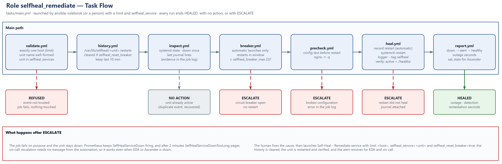

# selfheal_remediate — Heal One Service, Safely

Restarts one allow-listed systemd unit on one host, but only after checking that it should: the request is validated, the evidence is collected, a circuit breaker limits automatic restarts, and a configuration precheck refuses to restart a service whose configuration is broken. Every run ends in one of three ways: **HEALED** (with the outage timeline), **no action** (the unit is already active), or **ESCALATE** (the job fails on purpose and on-call is paged).

| | |
|---|---|
| **Target** | Ubuntu 26.04 LTS · Ubuntu 24.04 LTS (any systemd host) |
| **Requires** | ansible-core ≥ 2.16 · host in `selfheal_targets` with `selfheal_services` |
| **Playbook** | `playbooks/selfheal_remediate.yml` · Ascender job template **Self-Heal - Remediate service** |
| **Launched by** | ansible-rulebook (`extensions/eda/rulebooks/selfheal.yml`), as Ascender user `svc_eda` · or a person |
| **Validated** | Ubuntu 26.04.1 LTS · nginx 1.28.3 · 8/8 automatic heals, outage 31–39 s · breaker and precheck escalations |

## Contents

1. [Task flow](#1-task-flow)
2. [Usage](#2-usage)
3. [Decisions, and why](#3-decisions-and-why)
4. [Role files](#4-role-files)

---

## 1. Task flow

*Figure 1 — Main path and the four exits (source: [`selfheal_remediate-flow.drawio`](docs/selfheal_remediate-flow.drawio))*

---

## 2. Usage

### 2.1 Launched by Event-Driven Ansible

The rulebook sets the limit to the alert's `inventory_hostname` and passes `selfheal_service` (the alert label `name`) plus `ansible_eda` (the rule and the full alert). Nothing to do by hand: watch **Views → Jobs**, label `self-healing`.

### 2.2 Launched by a person

| Field | Value |
|---|---|
| **Limit** | `<HOST>` (exactly one host, or the job refuses) |
| **Extra variables** | `selfheal_service: nginx.service` |
| | `selfheal_reset_breaker: true` — after fixing an escalated incident: clears the history, then heals |

Manual launches are never blocked by the circuit breaker and are not counted in its history.

### 2.3 Variables

All in [`defaults/main.yml`](defaults/main.yml); lab values in `inventories/lab/group_vars/selfheal_targets.yml`.

| Variable | Default | Purpose |
|---|---|---|
| `selfheal_services` | `[]` | Allow-list: `unit`, optional `precheck` (command) and `health_url`. Empty = nothing can be healed. |
| `selfheal_service` | `""` | Unit to heal (set by the event). `.service` is added when missing. |
| `selfheal_breaker_max` / `selfheal_breaker_window_minutes` | `3` / `10` | Automatic restarts allowed per unit and host inside the window. |
| `selfheal_reset_breaker` | `false` | Clear the history first (the human closing an incident). |
| `selfheal_state_dir` | `/var/lib/selfheal` | Breaker history on the host, one epoch per line. |
| `selfheal_verify_retries` / `selfheal_verify_delay` | `10` / `3` | Attempts × seconds for "active" and the health URL. |
| `selfheal_journal_lines` | `20` | Journal lines shown as evidence. |

### 2.4 Job statistics

`set_stats` publishes `selfheal_result` (`healed` / `no_action`), `selfheal_unit`, `selfheal_outage_seconds`, `selfheal_automatic` and `selfheal_restarts_in_window` in the job artifacts, for dashboards or a follow-up workflow node.

---

## 3. Decisions, and why

| Decision | Why |
|---|---|
| Validate the event (`validate.yml`) | The extra vars come from an HTTP webhook. One host, a strict unit-name pattern and the host's own allow-list mean a forged or wrong alert cannot restart anything else. |
| Evidence before action (`inspect.yml`) | The person paged after an escalation reads the unit state and journal in the job log without logging in. |
| End early when the unit is active | Duplicate events and units that recovered by themselves cost one read-only job, not a restart. |
| Circuit breaker on the host (`breaker.yml`) | A unit that keeps dying hides a real problem; restarting it forever only hides it better. The history lives on the host, so it survives controller rebuilds and is visible on the server. |
| Precheck before restart (`precheck.yml`) | A broken configuration cannot be fixed by a restart: escalate with the exact error instead. |
| Record before restart (`heal.yml`) | A restart that hangs or kills the job still counts for the breaker. |
| Log on the host (`logger --tag selfheal`) | The host's own journal says who restarted the unit and from which Ascender job. |
| `gather_facts: false` | No fact is used; every second counts during an incident. |
| ESCALATE = failed job | No message to send: the unit stays down, and the Prometheus rule `SelfHealServiceDownTooLong` (`for: 2m`) pages on-call even when Ascender or the rulebook is the broken part. |

---

## 4. Role files

| File | Purpose |
|---|---|
| [`defaults/main.yml`](defaults/main.yml) | Every tunable, with its reason. |
| [`vars/main.yml`](vars/main.yml) | Derived path of the history file. |
| [`tasks/main.yml`](tasks/main.yml) | Order of the steps. |
| [`tasks/validate.yml`](tasks/validate.yml) | One host, unit format, allow-list, trigger. |
| [`tasks/history.yml`](tasks/history.yml) | Breaker history: reset, read, window. |
| [`tasks/inspect.yml`](tasks/inspect.yml) | Unit state, down-since, journal; end if active. |
| [`tasks/breaker.yml`](tasks/breaker.yml) | Escalate after too many automatic restarts. |
| [`tasks/precheck.yml`](tasks/precheck.yml) | Configuration test, escalate if broken. |
| [`tasks/heal.yml`](tasks/heal.yml) | Record, restart, log, verify (rescue: escalate). |
| [`tasks/report.yml`](tasks/report.yml) | Outage timeline and job statistics. |
| [`docs/`](docs/) | Task-flow diagram (draw.io + PNG). |
