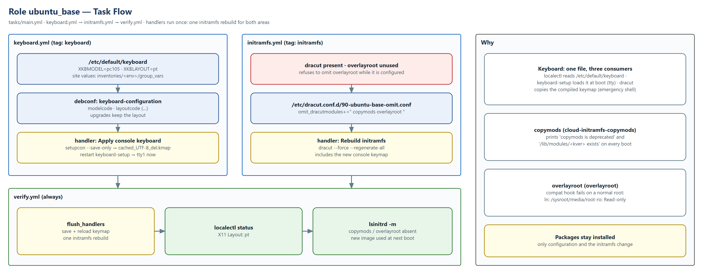

# ubuntu_base — General Ubuntu Settings

Settings every Ubuntu server gets that are **not** part of a CIS control: the **console keyboard layout** (Portuguese on this estate) and an **initramfs without unused dracut modules**, which removes the warnings Ubuntu 26.04 prints on every boot.

| | |
|---|---|
| **Target** | Ubuntu 26.04 LTS · Ubuntu 24.04 LTS (only acts where dracut builds the initramfs) |
| **Requires** | ansible-core ≥ 2.16 |
| **Playbook** | `playbooks/base.yml` · Ascender job template **Ubuntu Base - Apply** |
| **Validated** | Ubuntu 26.04.1 LTS · dracut 110 · console layout `pt` · boot without the three warnings |

## Contents

1. [Task flow](#1-task-flow)
2. [Usage](#2-usage)
3. [What the role changes, and why](#3-what-the-role-changes-and-why)
4. [Role files](#4-role-files)

---

## 1. Task flow



*Figure 1 — `keyboard.yml` and `initramfs.yml` change the configuration; `verify.yml` applies the handlers once and checks the result (source: [`ubuntu_base-flow.drawio`](docs/ubuntu_base-flow.drawio))*

---

## 2. Usage

### 2.1 Run order

| Step | Job template | Notes |
|---|---|---|
| 1 | Ubuntu Base - Apply, job type **Check** | Shows the keyboard and dracut changes as a diff |
| 2 | Ubuntu Base - Apply, job type **Run** | Applies the keyboard on the console immediately and rebuilds the initramfs once (1–4 minutes on a slow VM) |
| 3 | Reboot the host | The new initramfs (omitted modules, keymap of the emergency shell) is used from the next boot |

The role is idempotent: once everything is in place, a run reports `changed=0` and rebuilds nothing. Run only one area with the job tags `keyboard` or `initramfs`.

### 2.2 Variables

All in [`defaults/main.yml`](defaults/main.yml):

| Variable | Default | Purpose |
|---|---|---|
| `base_keyboard_layout` | `""` (lab: `pt`) | XKB layout of the console. Empty = keyboard not managed. |
| `base_keyboard_model` | `pc105` | XKB model (standard 105-key PC keyboard). |
| `base_keyboard_variant` / `base_keyboard_options` | `""` | XKB variant (e.g. `nodeadkeys`) and options (e.g. `ctrl:nocaps`). |
| `base_dracut_omit_modules` | `[copymods, overlayroot]` | dracut modules left out of the initramfs. Remove one on a host that uses it. |
| `base_allow_reboot` | `false` | Reboot automatically after rebuilding the initramfs. |

---

## 3. What the role changes, and why

### 3.1 Console keyboard layout (`tasks/keyboard.yml`)

On Ubuntu Server the console keyboard is handled by `console-setup`, and **one file drives everything**: `/etc/default/keyboard`.

| Consumer | What it does with the file |
|---|---|
| `systemd-localed` | `localectl status` reports it (`X11 Layout: pt`). |
| `keyboard-setup.service` | Loads the layout on the tty consoles at every boot. |
| `setupcon` → dracut | Compiles it to `/etc/console-setup/cached_UTF-8_del.kmap.gz`; the dracut `console-setup` module copies that keymap into the initramfs, so the emergency shell types with the same layout. |

What the role does, and why:

1. Sets `XKBMODEL`, `XKBLAYOUT`, `XKBVARIANT` and `XKBOPTIONS` in `/etc/default/keyboard`, line by line, keeping the rest of the file.
2. Sets the same answers in **debconf** (`keyboard-configuration/layoutcode`, `modelcode`, …). Without this, `dpkg-reconfigure keyboard-configuration` or a package upgrade could write the installer's layout (`us`) back.
3. Handler **Apply console keyboard**: `setupcon --save-only` rebuilds the cached keymap, then `keyboard-setup.service` is restarted, so the console uses the new layout immediately, without a reboot.
4. The initramfs is rebuilt (shared handler with 3.2), so early boot and the emergency shell also use the new layout.
5. `verify.yml` checks `localectl status`.

The equivalent manual procedure on one host is:

```bash
sudo sed -i 's/^XKBLAYOUT=.*/XKBLAYOUT="pt"/' /etc/default/keyboard
```
```bash
sudo setupcon --save-only && sudo systemctl restart keyboard-setup.service
```
```bash
sudo dracut --force --regenerate-all
```

Hosts with a desktop (GNOME) keep a per-user layout in `org.gnome.desktop.input-sources`; this role manages the system layout used by the console, the login screen and new users.

### 3.2 Boot warnings on Ubuntu 26.04

Ubuntu 26.04 builds the initramfs with dracut and installs two packages whose dracut modules run on every boot, even when the host does not use them:

| Boot message | Module (package) | Cause |
|---|---|---|
| `dracut-cmdline: Warning: Kernel command line option 'copymods' is deprecated, use 'rd.driver.export' instead.` | `copymods` (`cloud-initramfs-copymods`) | The hook prints the warning unconditionally and turns on module export, even with no `copymods` option on the kernel command line. |
| `dracut-pre-pivot: Warning: /lib/modules/<kver> exists. To export modules set rd.driver.export=force!` | `kernel-modules-export` (pulled in by `copymods`) | It tries to copy the kernel modules into the root filesystem; they are already there, so it warns and does nothing. |
| `dracut-pre-pivot: ln: failed to create symbolic link '/sysroot/media/root-ro': Read-only file system` | `overlayroot` (`overlayroot`) | Its compatibility hook always creates a symlink in the new root, which is still mounted read-only at that stage. The host does not use overlayroot. |

The messages are harmless, but they hide real problems in the boot log and add code the host never needs to the early boot.

### 3.3 The change

`/etc/dracut.conf.d/90-ubuntu-base-omit.conf`:

```text
omit_dracutmodules+=" copymods overlayroot "
```

Then `dracut --force --regenerate-all` rebuilds the initramfs of every installed kernel, and `lsinitrd -m` confirms that the modules are gone. `kernel-modules-export` disappears too, because only `copymods` required it.

- **Why omit instead of removing the packages**: other packages and metapackages depend on them, and future kernel updates keep using the same dracut configuration. Omitting only changes what goes into the initramfs and is undone by deleting one file.
- **Why not `rd.driver.export=0` on the kernel command line**: it silences the first two messages only. The `overlayroot` hook has no switch.
- **Safety**: the role refuses to omit `overlayroot` while overlayroot is configured (`/etc/overlayroot.conf` or `overlayroot=` / `rd.overlay` on the kernel command line). A host that relies on a read-only root would otherwise boot writable.

---

## 4. Role files

```text
defaults/main.yml          variables, with the reason for each default
tasks/main.yml             entry point: keyboard -> initramfs -> verify
tasks/keyboard.yml         /etc/default/keyboard and debconf (tag: keyboard)
tasks/initramfs.yml        dracut omit configuration (tag: initramfs)
tasks/verify.yml           applies the handlers once, checks localectl and lsinitrd
handlers/main.yml          console keymap save + reload, initramfs rebuild, optional reboot
docs/                      task-flow diagram (draw.io source + PNG export)
```
